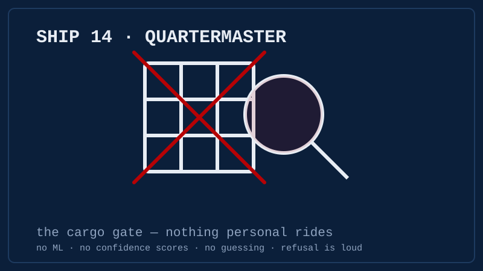

# Ship 14 — Quartermaster™ v1.0 · the cargo gate for public repos

*A Mirror of My Becoming™* — Ship 14. Gifted by **Evelyn Caro & Z**, November 2026.

A free, deterministic **PII/secret gate for git repositories** — the free
answer to paid scanners like AWS Macie for the one place they don't watch:
**the commit itself**. Zero cost, zero accounts, zero cloud, zero ML. One
Python file, standard library only. Built for one purpose: **prevent PII
from going into public repos.**



## Why it exists

The morning the falling-tree question got asked — *a refusal only matters
if someone hears it* — the fleet needed a gate that inspects every crate
before it goes aboard. Quartermaster stands at the gangway of every public
repo and refuses what a stranger could weaponize: keys, tokens, card
numbers, SSNs, addresses. Every refusal names the file, the line, the
rule, and a fixed written explanation. **No machine learning, no
confidence scores, no guessing.**

## Run it

```bash
python3 tools/pii/scan_pii.py --staged                        # before every commit
python3 tools/pii/scan_pii.py --git-diff "origin/master...HEAD"   # before every push
python3 tools/pii/scan_pii.py --all                           # whole-repo baseline
```

Enforcement needs nobody's memory:

- **`.githooks/pre-commit`** — stops the commit locally
  (`git config core.hooksPath .githooks`, once per clone)
- **`.github/workflows/quartermaster.yml`** — scans every push and PR
- **`LANE_PROMOTER_PATCH.yml`** — a step for blue→green promotion lanes
  that refuses to promote; a refusal also opens an issue, so the falling
  tree is heard
- **`AGENTS-MD-SECTION.md`** — paste into `AGENTS.md` so AI collaborators
  know the gate exists, run it before staging, and never bypass it

Full contract — every rule, every explanation: [`QUARTERMASTER.md`](./QUARTERMASTER.md).

## What it does

- **11 BLOCK rules** — AWS keys, GitHub tokens, `sk-` service keys, Google
  and Slack tokens, JWTs, private key material, SSN (strict shape,
  invalid areas excluded), Luhn-checked card numbers, key=value credentials.
  A BLOCK stops the commit and fails CI.
- **6 WARN rules** — email, phone, labeled DOB, street address, IP
  literals, bearer tokens. Reported loudly; intentional ones go in the
  allowlist.
- **Allowlist with reasons** — exact-value matching only; every entry
  carries a written reason. An entry *without* a reason makes the gate
  refuse to run (exit 2). Silent allowances are guessing by another name.
- **`--private` mode** — for sealed repos: suppresses identity WARNs,
  keeps every credential rule at BLOCK. Secrets do not ride even sealed ships.
- **Determinism** — severity is per-rule and permanent: the same rule
  yields the same verdict and the same words, every time. Exit codes:
  `0` clean · `1` BLOCK · `2` config error.

## Honest scope

Macie watches object storage continuously with ML at petabyte scale, paid
per gigabyte. Quartermaster watches the commit deterministically at human
scale, free, local-first. They overlap on "find PII" and diverge on
everything else — complementary, not competitive. Not affiliated with AWS;
"Macie" is named only to describe the gap this fills. Quartermaster
prevents new leaks; it cannot un-leak history already pushed — for that:
`git filter-repo` and rotate every credential involved.

## License

Dual-licensed: [`LICENSE`](./LICENSE) (AGPL-3.0 — free for classrooms,
nonprofits, and the public fleet) or
[`LICENSE-COMMERCIAL.md`](./LICENSE-COMMERCIAL.md) for proprietary use.
The free tier is the point; the AGPL is the guidance if the next user is a
corporation. Quartermaster™, Overseer™, Caro Command™ and A Mirror of My
Becoming™ are marks of the author.
